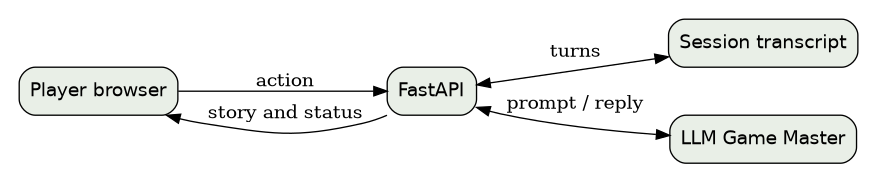
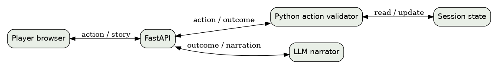

# The Locked Library — AI Escape Room

A browser-based escape room comparing two ways to build an AI game master: an LLM-controlled game and a Python-validated game with AI narration. Explore five objects, collect a brass key, follow clues and unlock the exit.

## Project goal

An LLM can tell an engaging story but may accept actions that violate the game rules. This project demonstrates that limitation in Version 1 and separates game decisions from storytelling in Version 2.

## Technologies

- Python 3.10 or newer
- FastAPI and Uvicorn for the web server
- HTML, CSS and JavaScript for the browser chat
- Groq's chat completion API, with `openai/gpt-oss-20b` as the configured default model
- python-dotenv for local configuration and unittest for automated tests

## Run locally

Download or clone this repository. Open a terminal **inside the project folder containing `app.py` and `requirements.txt`**.

### 1. Create the environment and install dependencies

```bash
python3 -m venv .venv
source .venv/bin/activate
python -m pip install -r requirements.txt
```

On Windows, activate with `.venv\Scripts\activate` instead.

### 2. Configure the model

For a new setup, copy the configuration template:

```bash
cp .env.example .env
```

Skip that copy if you already have a configured `.env`. On Windows, you can duplicate `.env.example` in your editor and name the copy `.env`.

Create your own key at [Groq Console](https://console.groq.com/keys), then edit `.env`:

```dotenv
GROQ_API_KEY=YOUR_OWN_GROQ_API_KEY
GROQ_MODEL=openai/gpt-oss-20b
```

Replace the placeholder with your key and save. Version 1 needs a working API connection. Version 2 can continue with Python-generated outcome text when AI narration is unavailable. API availability and usage limits depend on your provider account.

### 3. Start the app

```bash
python -m uvicorn app:app
```

Open [http://127.0.0.1:8000](http://127.0.0.1:8000). Choose a version and enter one action at a time. **Restart** clears the selected version's progress. Stop the server with Ctrl+C; restart it after configuration or code changes.

## Versions and architecture

| Area | Version 1 — AI Game Master | Version 2 — Validated rules |
|---|---|---|
| Main implementation | `v1.py`, with room instructions in `room.py` | `v2.py` |
| Decisions | LLM interprets the transcript and decides outcomes | Python validates actions and updates game state |
| State | Conversation history and model-supplied escape status | Explicit Python state for clues, inventory, locks and escape |
| Narration | Model-generated game response | Model describes only the approved outcome; Python appends the authoritative `Game result` |
| Model unavailable | Cannot generate the next game-master response | Returns the Python outcome as a fallback |
| Main trade-off | Flexible language, but inconsistent rule enforcement | Reliable rule enforcement, but a more restricted command grammar |

### Version 1



### Version 2



## What improved and why

In a live fresh-game test, Version 1 allowed the brass key to open the painting even though the player had not collected it. Version 2 rejected the same action and required the key first. Python now owns the game rules and state; generated narration cannot change them.

Version 1 refused the tested administrator and secret-code requests. These observations are recorded as successful refusals, not fabricated failures. Controlled tests separately demonstrate what happens when Version 1 receives incorrect model output.

Other development fixes included adding an application User-Agent after an HTTP 403 response, increasing the completion allowance from 512 to 2,048 after an empty response exhausted its token budget, and preserving line breaks in the chat. Version 2's initial fixed atmospheric phrases were replaced by generated narration with an authoritative outcome and a fallback.

## Playing the room

The five objects are the **desk, bookshelf, locked drawer, painting and exit door**. Start with `examine the desk`. Version 2 accepts common commands using verbs such as `examine`, `try`, `take` and `use`. Send each action separately.

<details>
<summary>Full playthrough — spoilers</summary>

1. `examine the desk`
2. `examine the bookshelf`
3. `try 274 on the drawer`
4. `take the brass key`
5. `use the brass key on the painting`
6. `enter 3816 at the exit`

The drawer clue tells the player to reverse the painting digits, turning 6183 into 3816.

</details>

## Tests and evidence

From the project folder, run:

```bash
python -m unittest discover -s tests -v
```

The recorded run passed **six test methods**. Coverage includes the complete Version 2 escape route, invalid actions preserving state, Version 1 transcript forwarding and model trust, and Version 2 narration fallback and authoritative-result inclusion. Invalid-action checks include multiple subcases.

Automated tests with scripted model responses are controlled simulations; they do not measure how often the live model fails. Live screenshots separately show both successful playthroughs, the missing-key comparison and the tested adversarial requests. The captured Version 2 escape playthrough predates the narration update and used offline narration.

- [Detailed test cases and observations](docs/tests.md)
- [Three-page project report](docs/report.pdf)
- [Demonstration notes](docs/demo.md)
- [Demonstration video](docs/demo.mp4)
- [Version 1 escape screenshot](docs/v1-escape.png)
- [Version 2 escape screenshot](docs/v2-escape.png)
- [Version 1 adversarial requests](docs/v1-adversarial.png)
- [Version 2 adversarial requests](docs/v2-adversarial.png)

## Main files

| File or folder | Purpose |
|---|---|
| `app.py` | FastAPI routes and application integration |
| `model.py` | Groq API client and configuration loading |
| `room.py` | Shared room description and puzzle instructions |
| `v1.py` | LLM-controlled gameplay |
| `v2.py` | Python validation, game state and narration |
| `templates/`, `static/` | Browser interface, styling and JavaScript |
| `tests/test_game.py` | Automated tests |
| `docs/` | Architecture diagrams, report, test documentation and demo evidence |
| `.env.example` | Configuration template without credentials |

## Limitations

- AI narration can still invent incidental details. A missing-key response referred to an unrelated door. The displayed Python game result remains authoritative; this does not guarantee that the prose is factually consistent.
- Version 2 may reject paraphrases outside its supported command grammar and expects one action per message.
- Progress is stored in memory and is cleared when the server process restarts. Each version maintains separate game history.
- Version 1 relies on model output for escape status; malformed status text has appeared in the narrative.
- Live-model responses vary. Passing the recorded tests does not prove that every possible input is handled correctly.

Future improvements include broader command parsing, checking narration against approved facts, and persistent game saves.

## Repository hygiene

Keep the real `.env` local and excluded through `.gitignore`. Commit `.env.example` with an empty API-key value. Exclude virtual environments, `__pycache__`, compiled Python files and temporary files. Keep any development Git bundle outside the published repository.

Maintain meaningful commits for code changes, fixes, tests and documentation. Submit the repository link and ensure that the instructor can access its code and supporting evidence.
